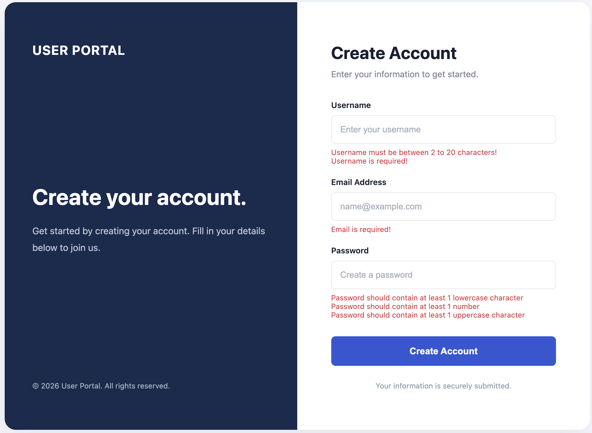

# User Registration Application

A Java-based web application that allows users to register an account with form validation and MySQL database integration.

## Homepage Screenshots




## Technologies Used

- Java
- Spring Boot
- Spring MVC
- Spring Data JPA
- Hibernate
- Thymeleaf
- MySQL
- Maven
- Jakarta Bean Validation
- HTML / CSS

## Features

- User registration form
- Form data binding using `@ModelAttribute`
- Server-side input validation using Jakarta Bean Validation
- Custom validation error messages
- User data persistence using Spring Data JPA
- MySQL database integration
- Automatic database schema updates using Hibernate

## Key Concepts

- Spring MVC: Handles HTTP requests and manages application flow.
- Thymeleaf: Renders dynamic HTML pages and binds form fields to Java objects.
- Spring Data JPA: Simplifies database operations through `CrudRepository`.
- Bean Validation: Validates user input using annotations such as `@NotBlank`, `@Size`, `@Email`, and `@Pattern`.

## Getting Started

### Prerequisites

- Java JDK 21
- Maven
- MySQL

### Run Locally

1. Clone the repository:
   ```bash
   git clone https://github.com/shan-jiang-dev/UserRegistration.git
   ```
2. Navigate to the project directory:
   ```bash
   cd UserRegistration
   ```
3. Create a MySQL database:
   ```sql
   CREATE DATABASE userregistration;
   ```
4. Configure your MySQL credentials in `src/main/resources/application.yml`.
5. Run the application:

   ```bash
   mvn spring-boot:run
   ```
6. Open your browser at:
   http://localhost:8080


## Author
Shan Jiang


